# Laboratorio #2: Implementación de Login y Registro en Laravel

**Universidad Tecnológica de Panamá**  
**Facultad de Ingeniería de Sistemas Computacionales — Campus Víctor Levi Sasso**  
**Asignatura:** Desarrollo Web  
**Tema:** Patrón Modelo–Vista–Controlador (MVC)  
**Docente:** Ing. Irina Fong

[](https://www.php.net/) [](https://laravel.com/) [](https://www.mysql.com/) [](https://getbootstrap.com/) [](https://nodejs.org/) [](https://getcomposer.org/)

## 1. Introducción y objetivo

En este laboratorio se realizó una primera aproximación al framework Laravel mediante la creación de un proyecto web con formularios de registro e inicio de sesión. Durante el desarrollo se identificaron las carpetas principales del proyecto y su relación con el patrón **Modelo–Vista–Controlador (MVC)**, además de configurar la conexión a MySQL, ejecutar las migraciones y utilizar Laravel UI con Bootstrap para generar las interfaces de autenticación.

El objetivo fue comprender cómo se organiza una aplicación Laravel, implementar el proceso básico de autenticación y comprobar que los usuarios registrados se almacenan en la base de datos y pueden iniciar y cerrar sesión correctamente.

### Resultado final

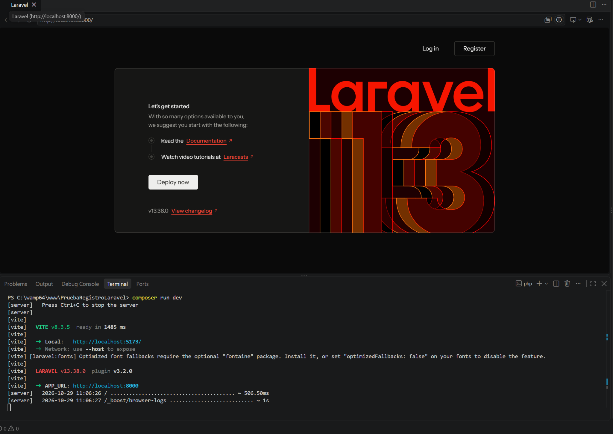

La aplicación se ejecutó localmente en **http://localhost:8000**. Las vistas de autenticación utilizan Bootstrap y la página de bienvenida conserva sus estilos originales.

## 2. Requisitos previos y herramientas utilizadas

| Herramienta | Versión del laboratorio | Utilidad |
|---|---|---|
| Windows | Entorno de escritorio utilizado | Sistema operativo |
| WampServer | Instalación local | Entorno de Apache y MySQL |
| PHP | 8.5.0 | Lenguaje de programación de Laravel |
| Composer | 2.10.3 | Dependencias PHP y Laravel UI |
| Laravel Framework | 13.38.0 | Framework principal y arquitectura MVC |
| Laravel UI | Serie 4.6, declarada en `composer.json` | Generación de vistas y rutas de autenticación |
| MySQL | 8.4.7 (versión indicada en el respaldo) | Base de datos relacional |
| phpMyAdmin | Incluido en WampServer | Administración y respaldo de la base de datos |
| Node.js | 24.21.0 | Entorno de herramientas frontend |
| npm | 12.2.0 | Instalación de dependencias JavaScript |
| Bootstrap | Serie 5, declarada en `package.json` | Estilos y componentes interactivos |
| Vite | 8.3.5 | Procesamiento y compilación de CSS y JavaScript |
| Visual Studio Code | Editor utilizado | Edición de código y terminal integrada |

Estas versiones de PHP, Composer, Node.js, npm y Laravel se comprobaron desde la terminal mediante `php -v`, `composer -V`, `node -v`, `npm -v` y `php artisan --version`.

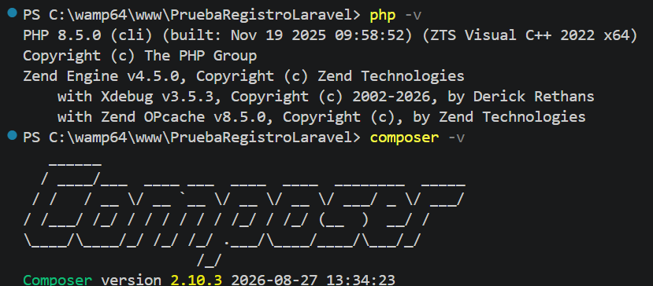

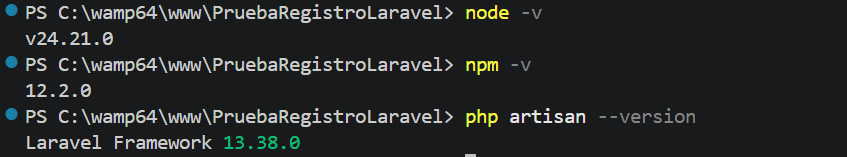

> **Compatibilidad:** para reproducir este proyecto debe comprobarse la versión requerida en `composer.json` (`php: ^8.3`), en lugar de utilizar únicamente la versión mínima ilustrativa de la guía docente.

## 3. Estructura del proyecto y arquitectura MVC

Laravel organiza el desarrollo mediante modelos, vistas y controladores, manteniendo separadas las responsabilidades del código:

| Componente | Archivo o carpeta utilizada | Función |
|---|---|---|
| **Modelo** | `app/Models/User.php` | Representa los usuarios almacenados en MySQL. |
| **Vista** | `resources/views/auth/login.blade.php` | Formulario de inicio de sesión. |
| **Vista** | `resources/views/auth/register.blade.php` | Formulario de registro. |
| **Vista** | `resources/views/home.blade.php` | Página mostrada después de iniciar sesión. |
| **Controlador** | `app/Http/Controllers/Auth/LoginController.php` | Gestiona la autenticación de usuarios. |
| **Controlador** | `app/Http/Controllers/Auth/RegisterController.php` | Valida y registra nuevos usuarios. |
| **Controlador** | `app/Http/Controllers/HomeController.php` | Muestra la página protegida `/home`. |
| **Rutas** | `routes/web.php` | Define las rutas web y registra las rutas de autenticación. |
| **Migraciones** | `database/migrations/` | Define las tablas necesarias para el proyecto. |

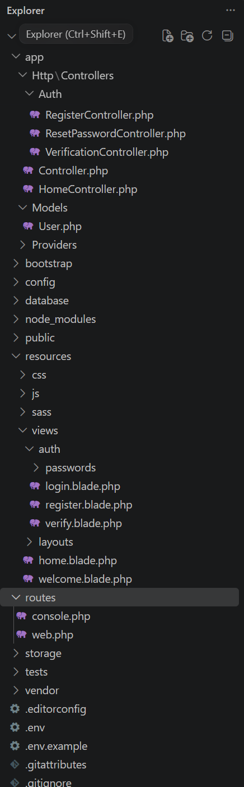

En `routes/web.php`, `Auth::routes()` registra las rutas de autenticación, mientras que la ruta `home` dirige hacia `HomeController`. El controlador aplica el middleware `auth` para restringir esa página a usuarios autenticados.

```php
Auth::routes();

Route::get('/home', [App\Http\Controllers\HomeController::class, 'index'])->name('home');
```

## 4. Desarrollo del laboratorio

### 4.1. Creación del proyecto

Primero se inició WampServer y se verificó el acceso a phpMyAdmin. Como el instalador global de Laravel ya estaba disponible, se creó el proyecto desde la carpeta `www`:

```powershell
cd C:\wamp64\www
laravel new PruebaRegistroLaravel
cd PruebaRegistroLaravel
code .
```

A partir de ese momento, los siguientes comandos se ejecutaron **dentro de `C:\wamp64\www\PruebaRegistroLaravel`**, desde la terminal integrada de Visual Studio Code.

Se utilizó Laravel sin un starter kit de autenticación, porque la guía solicitaba implementar posteriormente **Laravel UI con Bootstrap**.

### 4.2. Configuración de las variables de entorno

Desde phpMyAdmin se creó la base de datos `prueba_registro_laravel`. En el archivo `.env` local se configuró la conexión MySQL:

```dotenv
APP_URL=http://localhost:8000
DB_CONNECTION=mysql
DB_HOST=127.0.0.1
DB_PORT=3306
DB_DATABASE=prueba_registro_laravel
DB_USERNAME=root
DB_PASSWORD=
```

**Nota de seguridad:** los valores anteriores corresponden a la configuración local de prueba; en otra instalación deben reemplazarse por sus propias credenciales. El valor de `APP_KEY` se omitió de las capturas porque es una clave privada utilizada por Laravel para sus funciones de cifrado. El archivo `.env` real **no se incluye** en este repositorio. Se proporciona `.env.example` sin secretos para facilitar la configuración.

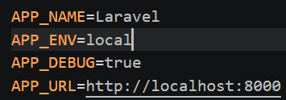

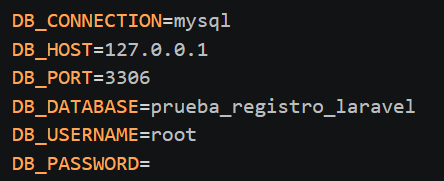

Para actualizar la configuración y ejecutar las migraciones se utilizaron estos comandos:

```powershell
php artisan config:clear
php artisan config:cache
php artisan migrate
```

### 4.3. Instalación de Laravel UI y Bootstrap

Después de comprobar la ejecución inicial del proyecto, se instaló el paquete de autenticación:

```powershell
composer require laravel/ui
php artisan ui bootstrap --auth
npm install
npm run build
```

El comando `php artisan ui bootstrap --auth` generó las vistas de inicio de sesión y registro, controladores relacionados y los recursos frontend de Bootstrap.

El proyecto utiliza tanto los estilos originales de bienvenida de Laravel (Tailwind CSS) como Bootstrap para los formularios de autenticación. Por ello se ajustó `vite.config.js` para procesar ambas hojas de estilo y el JavaScript:

```javascript
input: [
    'resources/css/app.css',
    'resources/sass/app.scss',
    'resources/js/app.js',
],
```

También se añadió la importación `import './bootstrap';` a `resources/js/app.js`. Posteriormente se instaló Axios, una dependencia necesaria para compilar el archivo `resources/js/bootstrap.js` del proyecto:

```powershell
npm install axios
npm run build
```

La compilación finalizó correctamente y generó los recursos CSS y JavaScript.

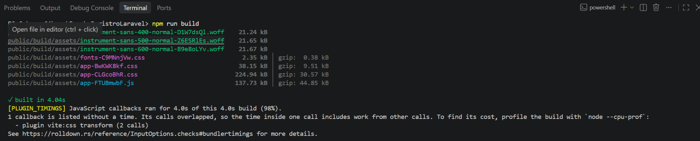

### 4.4. Ejecución de la aplicación

Para ejecutar el proyecto se utilizó:

```powershell
composer run dev
```

En la instalación utilizada, este comando inició el servidor de desarrollo de Laravel y Vite. La aplicación pudo abrirse en **http://localhost:8000**. Para detener los procesos desde Windows se utilizó `Ctrl + C`.

## 5. Base de datos y migraciones

Las migraciones definen las tablas y permiten crear su estructura de manera controlada. Para comprobar su estado se ejecutó:

```powershell
php artisan migrate:status
```

La terminal confirmó como ejecutadas las siguientes migraciones:

| Migración | Estado |
|---|---|
| `0001_01_01_000000_create_users_table` | Ran |
| `0001_01_01_000001_create_cache_table` | Ran |
| `0001_01_01_000002_create_jobs_table` | Ran |

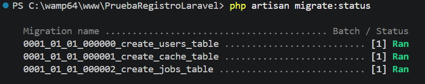

En phpMyAdmin se comprobaron **nueve tablas**: `cache`, `cache_locks`, `failed_jobs`, `jobs`, `job_batches`, `migrations`, `password_reset_tokens`, `sessions` y `users`.

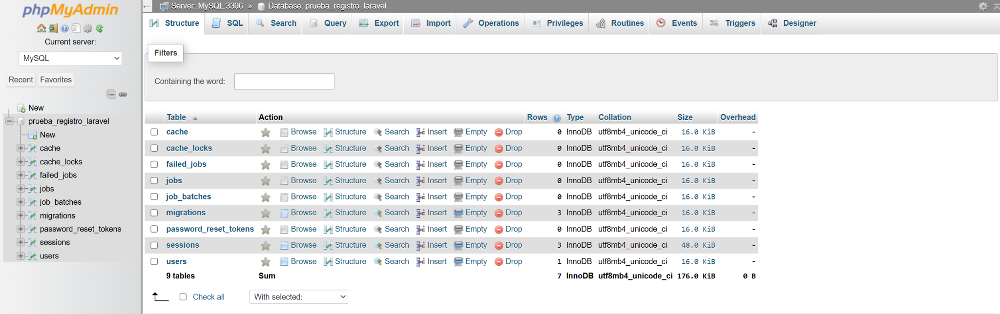

### Respaldo SQL

Se incluye una copia publicable del respaldo en [`database/backup/prueba_registro_laravel.sql`](database/backup/prueba_registro_laravel.sql).

**Por privacidad, este respaldo conserva las nueve tablas y los registros de control de migraciones, pero se quitaron los registros reales de `users` y `sessions`.** Por lo tanto, al importarlo no aparecerá el usuario personal utilizado durante la práctica; para probar el registro debe crearse uno nuevo. El respaldo original sin depurar se mantiene fuera de esta entrega.

## 6. Resultados de la implementación

### 6.1. Formulario de registro

La vista `/register` permite ingresar nombre, correo electrónico, contraseña y confirmación. Los datos se validan antes de crear el usuario en MySQL.

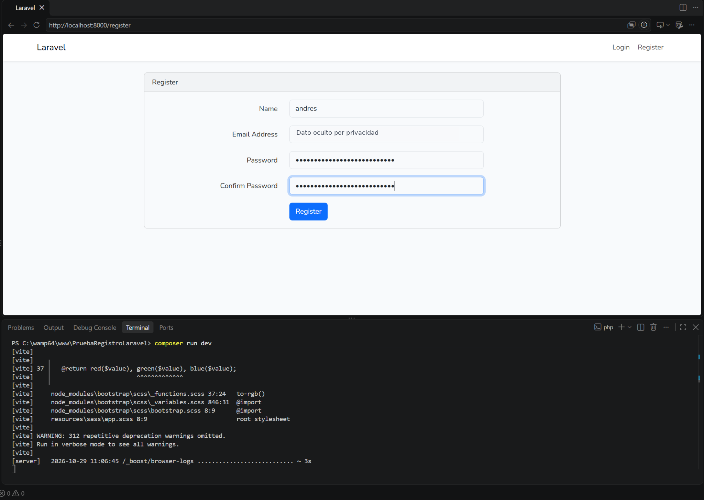

### 6.2. Formulario de inicio de sesión

La vista `/login` permite acceder utilizando el correo y la contraseña del usuario registrado.

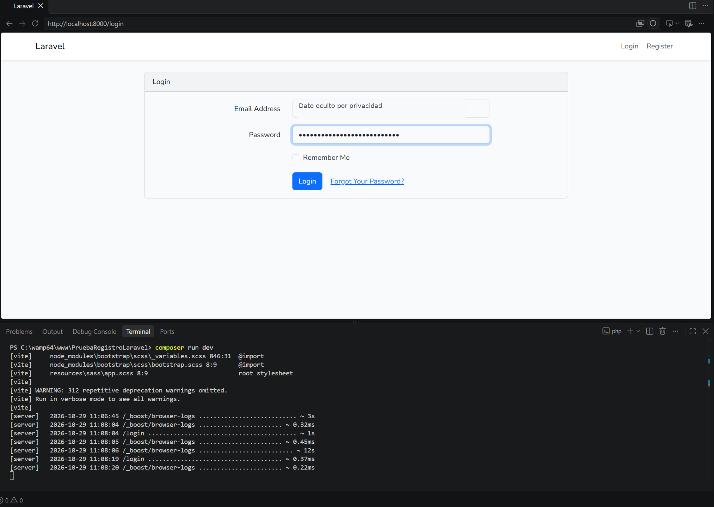

### 6.3. Comprobación de la sesión

Después de iniciar sesión se muestra la página `/home`, con el mensaje **«You are logged in!»**. La aplicación reconoce al usuario autenticado y le permite acceder a su panel.

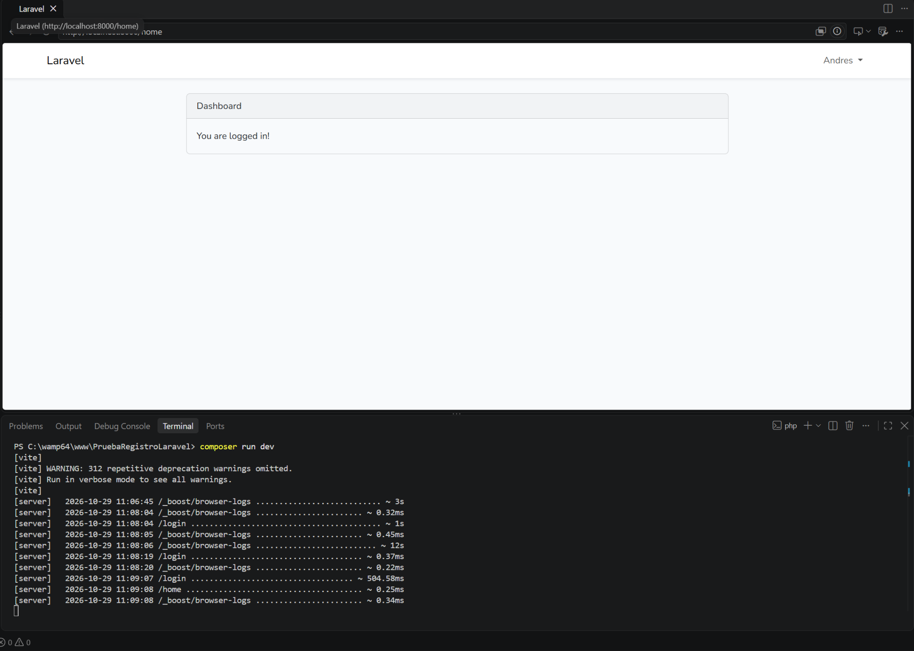

### 6.4. Usuario almacenado en MySQL

La tabla `users` contenía un registro creado durante la prueba. Se ocultaron sus datos identificativos en la captura publicada.

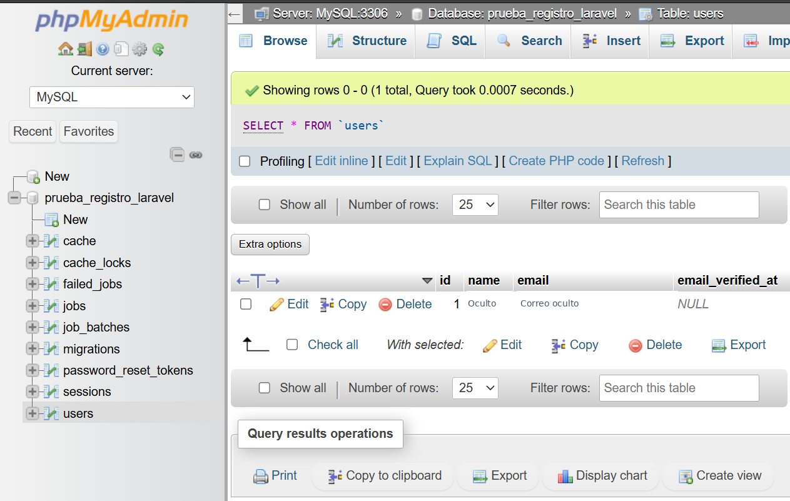

### 6.5. Cierre de sesión (Logout)

En la barra superior, el nombre del usuario abre un menú desplegable con la opción **Logout**. Después de seleccionarla, la página principal vuelve a mostrar los enlaces de acceso **Log in** y **Register**.

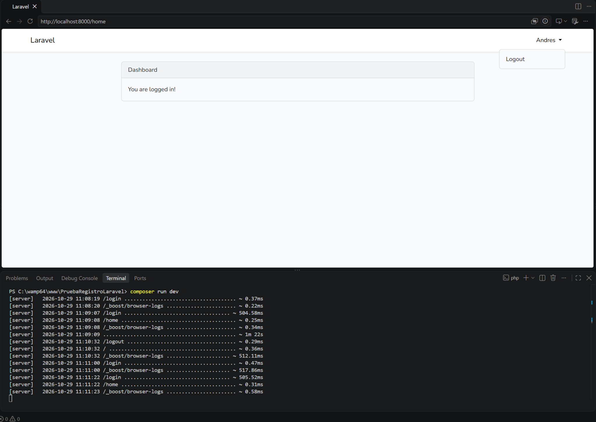

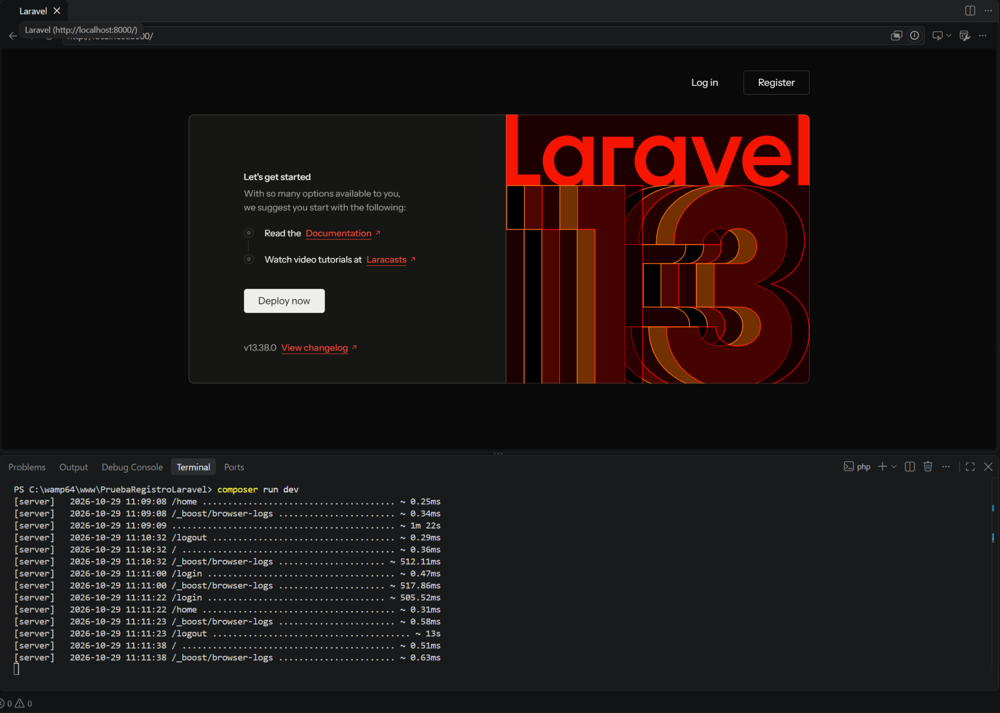

## 7. Dificultades encontradas y soluciones aplicadas

| Dificultad | Causa identificada | Solución aplicada |
|---|---|---|
| La página principal perdió sus estilos después de instalar Laravel UI. | La configuración de Vite utilizada por Bootstrap no incluía los estilos originales de la página de bienvenida. | Se modificó `vite.config.js` para compilar Tailwind CSS y Bootstrap, y se ejecutó nuevamente `npm run build`. |
| La opción **Dashboard** llevaba a un error `404 Not Found`. | La página de bienvenida apuntaba a `/dashboard`, mientras que Laravel UI utilizaba `/home`. | Se cambió el enlace en `resources/views/welcome.blade.php` para utilizar `route('home')`. |
| No se desplegaba el menú del usuario ni aparecía **Logout**. | No se estaba cargando correctamente el JavaScript de Bootstrap desde el archivo principal. | Se agregó `import './bootstrap';` en `resources/js/app.js`. |
| La compilación de Vite falló porque no encontraba Axios. | `resources/js/bootstrap.js` importaba Axios y el paquete no estaba instalado. | Se ejecutó `npm install axios` y después `npm run build`. |
| Aparecieron advertencias de Sass durante la compilación. | Bootstrap utiliza algunas funciones de Sass marcadas como obsoletas. | Se comprobó que eran advertencias y que la compilación terminaba correctamente. |

Estas dificultades permitieron comprender mejor la relación entre las vistas, las rutas, las dependencias de JavaScript y la configuración de recursos en Laravel.

## 8. Cómo instalar y ejecutar este repositorio en otra computadora

> **Esta sección explica cómo reproducir el proyecto descargado de GitHub.** No debe confundirse con la secuencia histórica de comandos utilizada para crear el laboratorio.

1. Tener instalado PHP compatible (según `composer.json`, PHP 8.3 o superior dentro de su rango compatible), Composer, Node.js, npm y MySQL.
2. Descargar o clonar el repositorio y abrir una terminal **dentro de la carpeta `PruebaRegistroLaravel`**.
3. Instalar las dependencias PHP y frontend:

   ```powershell
   composer install
   npm install
   ```

4. Crear el archivo local `.env` a partir del ejemplo y generar una nueva clave de aplicación:

   ```powershell
   Copy-Item .env.example .env
   php artisan key:generate
   ```

5. Crear en phpMyAdmin la base `prueba_registro_laravel` y verificar en `.env` el puerto, usuario y contraseña de MySQL. A continuación, ejecutar **una de estas alternativas**:

   - **Alternativa A (migraciones):** `php artisan migrate` para crear las tablas desde Laravel.
   - **Alternativa B (respaldo):** importar en una base vacía el archivo `database/backup/prueba_registro_laravel.sql` desde phpMyAdmin. Este respaldo ya incluye las tablas y el historial de migraciones; no es necesario reconstruirlas con `migrate`.

6. Limpiar la configuración si se modificó `.env`, compilar los recursos y ejecutar el servidor:

   ```powershell
   php artisan config:clear
   npm run build
   composer run dev
   ```

7. Abrir `http://localhost:8000/register`, registrar un **usuario de prueba nuevo**, visitar `/home` y utilizar **Logout** para cerrar la sesión.

**Importante:** el respaldo incluido contiene estructura e historial de migraciones, no datos personales ni cuentas utilizables. No subas al repositorio tu archivo `.env`, claves ni respaldos con usuarios reales.

## 9. Referencias

1. Laravel. (s. f.). *Installation*. https://laravel.com/docs/13.x/installation
2. Laravel. (s. f.). *Database: Migrations*. https://laravel.com/docs/13.x/migrations
3. Laravel. (s. f.). *Laravel UI* [Repositorio de código]. GitHub. https://github.com/laravel/ui
4. Vite. (s. f.). *Getting Started*. https://vite.dev/guide/
5. phpMyAdmin. (s. f.). *Documentation*. https://docs.phpmyadmin.net/

## 10. Fecha de ejecución e información del estudiante

**Fecha de ejecución:** 22 Octubre de 2026.  
**Fecha de entrega:** 23 de Octubre del 2026.

---

Este laboratorio ha sido desarrollado por un estudiante de la **Universidad Tecnológica de Panamá**.

- **Nombre:** Andres Dommar.
- **Curso:** Desarrollo Web.
- **Instructora del laboratorio:** Ing. Irina Fong.

**Nota de publicación:** se han omitido datos personales en las capturas y en la copia SQL, sin modificar las pruebas realizadas en el entorno original.
